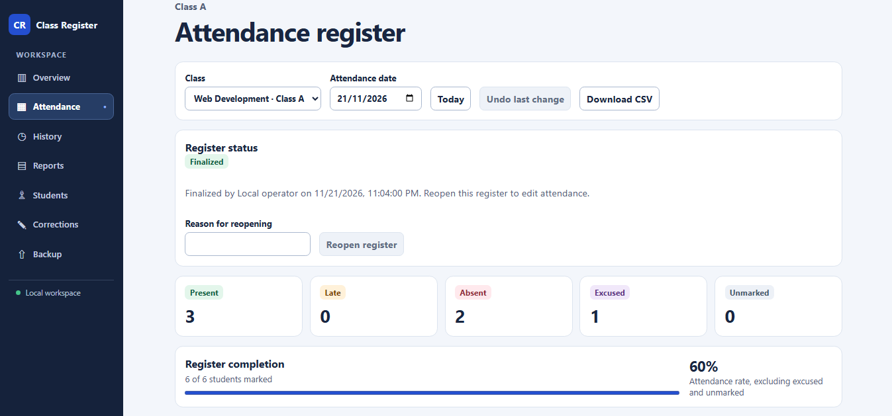
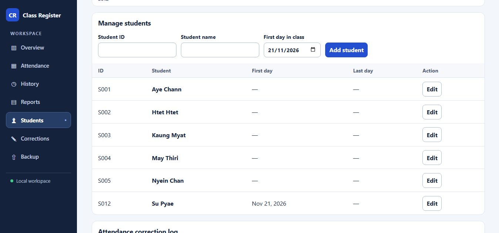
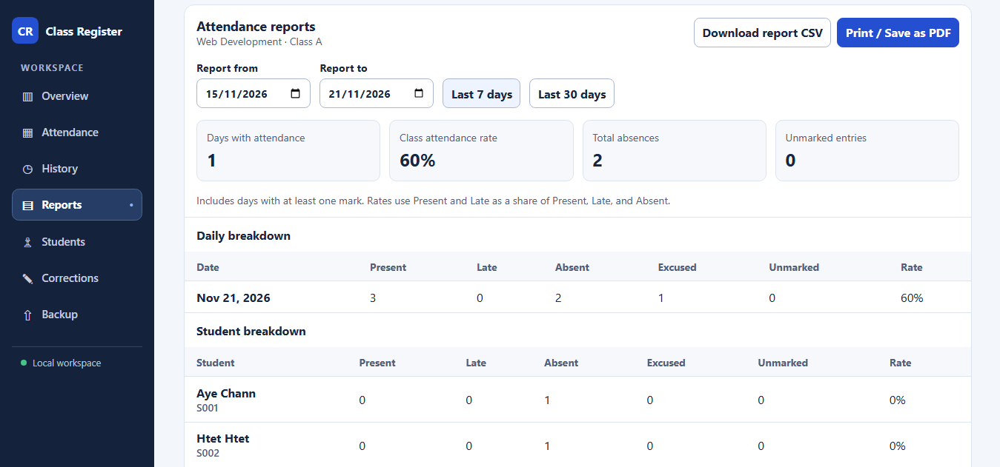
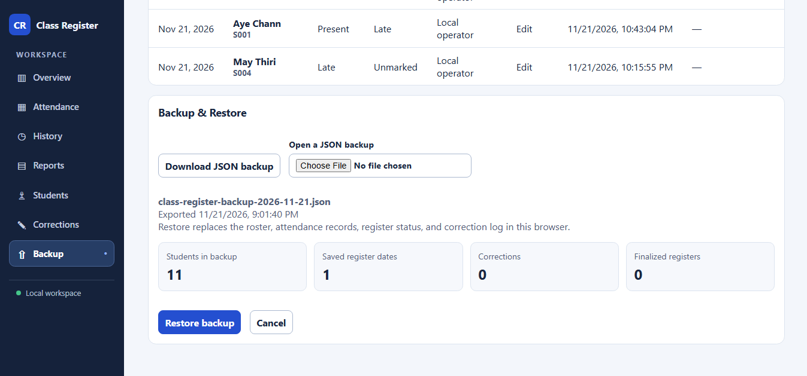

# React + Vite

This template provides a minimal setup to get React working in Vite with HMR and some Oxlint rules.

Currently, two official plugins are available:

- [@vitejs/plugin-react](https://github.com/vitejs/vite-plugin-react/blob/main/packages/plugin-react) uses [Oxc](https://oxc.rs)
- [@vitejs/plugin-react-swc](https://github.com/vitejs/vite-plugin-react/blob/main/packages/plugin-react-swc) uses [SWC](https://swc.rs/)

## React Compiler

The React Compiler is not enabled on this template because of its impact on dev & build performances. To add it, see [this documentation](https://react.dev/learn/react-compiler/installation).

## Expanding the Oxlint configuration

If you are developing a production application, we recommend using TypeScript with type-aware lint rules enabled. Check out the [TS template](https://github.com/vitejs/vite/tree/main/packages/create-vite/template-react-ts) for information on how to integrate TypeScript and Oxlint's TypeScript related rules in your project.


# Class Register – Student Attendance Dashboard

Class Register is a student attendance management application I built using React.js. It helps teachers manage student information, record daily attendance, check attendance history, and generate reports in one place.

I wanted to build something practical rather than just a basic React project, so I included features that could be useful in a real classroom.

## Dashboard Preview

### 1. Attendance Dashboard
Manage daily attendance and monitor class attendance statistics.



### 2. Student Management
Add students, update student information, and manage enrollment records.



### 3. Attendance Reports
Review attendance percentages, daily records, and individual student performance.



### 4. Backup and Restore
Download JSON backups and restore previously saved attendance data.




## Features

### 1. Attendance Management
- Record attendance for different classes and dates.
- Mark students as Present, Late, Absent, or Excused.
- Mark all remaining unmarked students as Present.
- Search for students by name or ID.
- Filter the roster by attendance status.
- View attendance totals and completion rates.

### 2. Student Management
- Add new students and update their information.
- Assign a unique ID to each student.
- Set enrollment start and end dates.
- Keep student records organised by class.

### 3. Attendance History
- View attendance records from previous dates.
- Check attendance details for each class.
- See whether a register is still open or has been finalized.
- Reopen a finalized register when a correction is needed.

### 4. Register Finalization
- Finalize a register after all students have been marked.
- Lock completed attendance records to prevent accidental changes.
- Reopen a register by providing a reason.
- Keep a record of register changes and corrections.

### 5. Reports
- View attendance summaries and percentages.
- Generate reports for selected date ranges.
- Check daily and individual student attendance.
- Export reports as CSV files.
- Print reports or save them as PDF.

### 6. Backup and Restore
- Download attendance data as a JSON file.
- Preview backup details before restoring.
- Restore student records and attendance history.
- Keep finalized register information and correction records in backups.

## Technologies Used

| Technology | How I used it |
|---|---|
| React.js | Building the user interface and components |
| JavaScript (ES6+) | Handling application logic and functionality |
| HTML5 | Structuring the application |
| CSS3 | Designing the dashboard and layouts |
| Vite | Running the development server and building the project |
| Git & GitHub | Managing and tracking code changes |
| Local Storage | Saving student and attendance data in the browser |

## Getting Started

If you want to run this project on your computer, follow these steps.

### Requirements
- Node.js
- npm
- Visual Studio Code (or another code editor)

### Installation

**1. Clone the repository**

```bash
git clone https://github.com/Ei359/class-register.git
```

**2. Open the project folder**

```bash
cd class-register
```

**3. Install the dependencies**

```bash
npm install
```

**4. Start the development server**

```bash
npm run dev
```

**5. Open the application**

Open the local URL shown in your terminal. It is usually:

```text
http://localhost:5173
```

## Building the Project

To create a production build, run:

```bash
npm run build
```

If you want to check the code for linting issues and the project has a lint script, run:

```bash
npm run lint
```

## Data Storage

The application currently uses browser Local Storage to save student information, attendance records and correction history.

I also added JSON backup and restore functionality so users can download their data and restore it when needed.

At the moment, this is a frontend application. It does not yet have a backend database, user login system, or cloud synchronisation. The data is stored locally in the browser.

## What I Plan to Improve

There are still some features I would like to work on in the future:

- Connect the application to a backend database.
- Add user login and different access levels for teachers and administrators.
- Introduce QR code attendance scanning.
- Add automatic absence notifications.
- Allow data to be synchronised across different devices.
- Improve attendance analytics and reporting.

## About This Project

I built Class Register as a practical project to improve my understanding of React.js and frontend development.

While working on it, I gained experience with React components, JavaScript logic, managing application data, browser Local Storage, Git, and GitHub.

There are still improvements I would like to make, but this project has given me a better understanding of how to develop and organise a functional web application.
